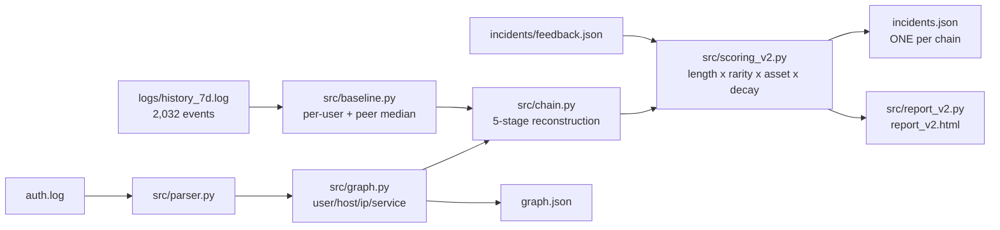
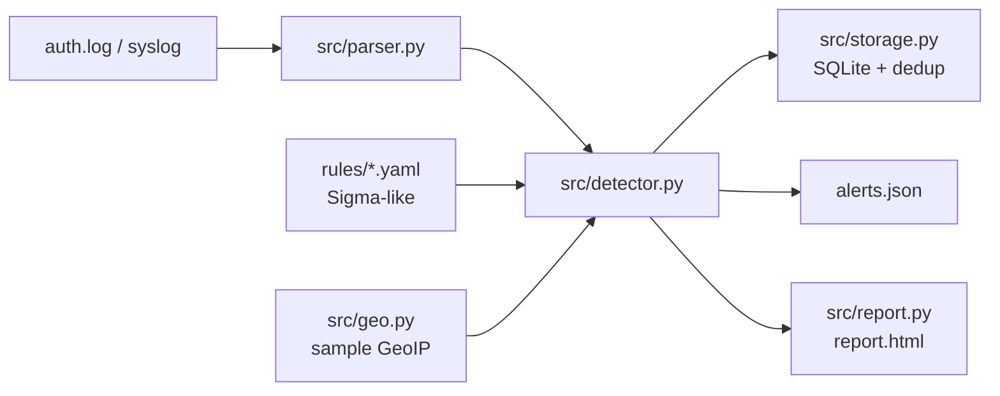

# 🛡️ SOC Sentinel Lite


A **mini SOC / SIEM in pure Python** — no external dependencies, no network access, no setup.
Feed it auth/syslog-style logs and it detects attacks, maps them to **MITRE ATT&CK**,
scores the risk, stores alerts in SQLite, and builds a self-contained HTML report.

Built as a portfolio project for SOC Analyst / Detection Engineering roles.

> **Sample data only.** Every IP in the bundled logs is an RFC 5737 documentation
> address (`192.0.2.0/24`, `198.51.100.0/24`, `203.0.113.0/24`). Nothing here
> touches a live host, a real credential, or a real network.

---

## v2.0 — Advanced: Sentinel Graph — Temporal Attack-Chain Reconstruction

**v1 is kept intact** (`sentinel.py`, 14 tests, still passing). v2 is a second
engine alongside it (`sentinel_v2.py`, 19 new tests) built on one original
idea: **an attack is a path through a graph, not a single alert.**

### The original concept

A tutorial SIEM scores isolated lines: 5 failures in 5 minutes = alert,
a login after it = another alert, a sudo abuse = a third. A real
intrusion is none of those alone — it is a *sequence* that unfolds over
hours, across IPs and hosts. And a slow attacker deliberately stays
under every fixed threshold, while a normal user who mistypes five
times crosses it by accident.

Sentinel Graph fixes both failures at once:

1. **Temporal entity graph** (`src/graph.py`) — every event becomes
   timestamped edges between typed nodes (`user`, `host`, `ip`,
   `service`). An attack is a walk through that graph; a normal user
   walks a small, familiar subgraph they have always used.
2. **Peer-group behavioural baselining** (`src/baseline.py`) — per-user
   normal login hours, hosts, IPs and failure rate, learned from a
   synthetic 7-day history (`logs/history_7d.log`, 2,032 events,
   generated by `scripts/generate_history.py`). Peer comparison uses
   the *median*, so one attacked account cannot drag the baseline.
   Each event gets a rarity score (0–1) with human-readable reasons.
3. **Attack-chain reconstruction** (`src/chain.py`) — stages are linked
   only if they share a user (and, where relevant, IP/host) inside a
   24-hour window, in causal order:
   brute force (fast / **slow** / **distributed** / mixed) →
   initial access → privilege escalation → lateral movement →
   data staging. One chain = **one incident**, with chain length,
   time span and MITRE technique sequence — not seven alerts.
   IP-anchored clusters also catch enumeration (many usernames,
   one IP), which per-user clustering alone misses entirely.
4. **Chain risk scoring** (`src/scoring_v2.py`) —
   `risk = chain_length × rarity × asset_criticality × time-decay`,
   × an analyst-feedback multiplier. Chains below 40 are
   *suppressed, not hidden* — they are listed in the report with
   their score and reason, so the false-positive control is auditable.
   Marking a pattern false-positive in `incidents/feedback.json`
   re-weights it on the next run.

### How this differs from every tutorial SIEM

| | Tutorial SIEM / v1 | Sentinel Graph v2 |
|---|---|---|
| Unit of detection | One rule, one window, one alert | One *chain*, one incident |
| Slow brute force (<5/hr over 6 h) | Missed — under threshold | Detected — 6-hour sliding window |
| Distributed brute force (3+ IPs, one user) | Missed — per-IP counts stay low | Detected — per-user + per-IP clusters |
| Normal user mistyping 5× | Critical alert (and, in v1, critical alerts for *other* users on the same IP) | Suppressed — known IP/host/hour, rarity 0.0, risk 8 |
| Scoring | Severity + count | Chain length × rarity × asset × decay × feedback |
| Learning | None — thresholds are fixed | 7-day peer-group baseline, analyst feedback re-weights |
| Output | Alert list | Incident + entity graph (`graph.json`, Gephi/NetworkX-ready) |

### Architecture (v2)



```
sentinel_v2.py         v2 CLI entry point
src/
  graph.py             temporal entity graph, JSON export / round-trip
  baseline.py          peer-group baselining, rarity 0-1 with reasons
  chain.py             brute-force clusters + 5-stage chain reconstruction
  scoring_v2.py        chain risk scoring + analyst-feedback re-weighting
  report_v2.py         incident HTML report (chains + suppressed, auditable)
scripts/generate_history.py   deterministic 7-day history generator (seed 42)
logs/history_7d.log    2,032 synthetic events, Nov 13-19 2026
logs/advanced_chain.log   5-stage chain v1 misses (slow + distributed)
logs/normal_user.log   normal mistype burst v1 flags as 3x critical
incidents/feedback.json   analyst feedback (alice mistype = false positive)
tests/test_v2.py       19 new tests (33 total with v1)
```

### v2 usage — the proof, run for real

```bash
# The full 5-stage chain v1 misses (slow + distributed brute force,
# then login, sudo escalation, lateral move to db01, tar/scp staging)
python3 sentinel_v2.py --input logs/advanced_chain.log --history logs/history_7d.log \
  --output report_v2.html --json incidents.json --graph graph.json
```

```
[+] Parsed 46 events from logs/advanced_chain.log (1888 events/sec)
[+] Baseline learned from 2032 history events (5 users, peer failure-rate median 0.021)
[+] Graph: 12 nodes, 118 edges
[+] 1 chain(s) reconstructed, 1 incident(s) >= threshold 40, 0 suppressed
    [CRITICAL] 100  INC-DEPLOY-20261121-0235-01 user=deploy stages=5
    (T1110.001 -> T1078 -> T1548.003 -> T1021.004 -> T1074)
    2026-11-21T02:35:00 -> 2026-11-21T09:20:00
```

One incident, not seven alerts. v1 on the same file fires **only R006**
(sudo abuse) — it never sees the brute force, the login, the lateral
move or the staging at all.

```bash
# The original sample log, through v2: 1 incident + 1 suppressed chain
python3 sentinel_v2.py --input logs/sample_auth.log --history logs/history_7d.log \
  --output /tmp/report_sample.html --json /tmp/incidents_sample.json --graph /tmp/graph_sample.json
# [HIGH] 65  INC-ADMIN-2026... user=admin stages=2 (T1110.001 -> T1078)
# [SUPPRESSED] 32  user=admin stages=1 — enumeration with no success

# The normal user v1 flags as 3x critical: v2 suppresses her
python3 sentinel_v2.py --input logs/normal_user.log --history logs/history_7d.log \
  --output /tmp/report_normal.html --json /tmp/incidents_normal.json --graph /tmp/graph_normal.json
# 1 chain(s) reconstructed, 0 incident(s), 1 suppressed
# [SUPPRESSED] 8  user=alice stages=2 — risk 8 < threshold 40
# (v1 on the same file: 4 alerts, 3 of them CRITICAL R002 — for alice,
#  bob and carol, two of whom did nothing at all)
```

### Benchmark (measured, this sandbox)

| Input | Events | Time | Throughput |
|---|---|---|---|
| `logs/history_7d.log` (as input) | 2,032 | 0.053 s | **38,257 events/sec** |
| `logs/sample_auth.log` | 146 | ~0.02 s | ~7,100 events/sec |
| `logs/advanced_chain.log` | 46 | ~0.02 s | ~1,900 events/sec |

Throughput is dominated by baseline scoring on small files; on the
2,032-event history it is ~38k events/sec end-to-end (parse + graph +
baseline + chaining + scoring + reports). Numbers vary by machine —
re-run with `time python3 sentinel_v2.py --input logs/history_7d.log …`
to reproduce them. Pure stdlib, no parallelism yet; the chain
reconstruction is O(users × window) and the graph is O(events).

### v2 limitations (honest)

- **Baseline needs history** — with no history file v2 degrades to
  "unseen = moderately rare" (0.5); it does not invent a baseline.
- **Chains are anchored on brute force** — an intrusion with no
  failed-login precursor (stolen session token, valid credentials
  with no guessing) builds no chain yet; that is the next stage to add.
- **Staging detection is keyword-based** (`tar`/`scp`/`rsync`/
  `/etc/shadow`) — a real deployment would add process / file telemetry.
- **Asset criticality is a static map** (`db01` 1.4, `web01` 1.0) —
  it should come from a CMDB in production.
- **No streaming yet** — v2 is batch, like v1; the graph is rebuilt
  per run rather than maintained incrementally.

---

## What it does

| Stage | What happens |
|---|---|
| **Ingest** | Parses syslog / `auth.log` lines (`sshd`, `sudo`, `CRON`) into structured events |
| **Detect** | Correlates events against 6 Sigma-like YAML rules with sliding time windows |
| **Map** | Tags every alert with MITRE ATT&CK tactic + technique |
| **Score** | Risk score 0–100 from severity + observed count |
| **Store** | Persists alerts in SQLite with deduplication (re-ingesting the same log adds nothing) |
| **Report** | Emits a single self-contained `report.html` + machine-readable `alerts.json` |

## Why it matters for SOC roles in 2026

Hiring for SOC Analyst / Tier-1 roles now expects more than "I know what a SIEM is":
knowing **how detection actually works** — parsing, correlation windows, false-positive
control, MITRE mapping, and triage-ready output. This project demonstrates exactly that,
in ~600 lines of readable stdlib Python that a reviewer can run in 30 seconds with no
install step. It mirrors the real workflow of Splunk / Sentinel / Elastic detection
rules, minus the vendor lock-in.

## Architecture



```
sentinel.py            CLI entry point (argparse)
src/
  parser.py            syslog/auth.log line parser -> structured events
  rules.py             Sigma-like YAML loader (hand-rolled, stdlib only)
  detector.py          sliding-window correlation engine (R001-R006)
  geo.py               static sample IP -> country map (impossible travel)
  storage.py           SQLite alert store with UNIQUE-key dedup
  report.py            single-file HTML report generator
rules/                 one YAML file per detection rule
logs/sample_auth.log   146 realistic lines: normal traffic + 6 attack scenarios
tests/test_detector.py unittest suite (14 tests)
tests/test_v2.py         v2 suite (19 tests) — 33 total
```

## Detection rules

| ID | Rule | MITRE | Severity | Trigger |
|---|---|---|---|---|
| R001 | SSH Brute Force | T1110.001 Password Guessing | High | 5+ failed logins, one IP, 5 min |
| R002 | Successful Login After Brute Force | T1078 Valid Accounts | **Critical** | Success from a brute-forcing IP within 30 min |
| R003 | Direct Root Login | T1078 Valid Accounts | High | Any successful `root` SSH login |
| R004 | SSH User Enumeration | T1595.001 Active Scanning | Medium | 8+ distinct usernames, one IP, 10 min |
| R005 | Impossible Travel | T1078 Valid Accounts | High | Same user, two countries, within 60 min |
| R006 | Sudo Privilege Escalation Attempts | T1548.003 Sudo and Sudo Caching | High | 3+ failed sudo attempts, one user, 10 min |

Rules are data, not code: tune `threshold`, `window_minutes` or `severity` in
`rules/*.yaml` and re-run — no Python changes needed. Disable a rule with `enabled: false`.

## Install

```bash
git clone https://github.com/<your-username>/soc-sentinel-lite.git
cd soc-sentinel-lite
# No dependencies to install — Python 3.9+ standard library only.
python3 --version
```

## Usage

```bash
python3 sentinel.py --input logs/sample_auth.log --output report.html --json alerts.json
```

Expected output (exact, from the bundled sample log — 146 events):

```
[+] Parsed 146 events from logs/sample_auth.log
[+] Loaded 6 rules from rules
[+] 7 alert(s) detected (critical=1, high=5, medium=1)
    [CRITICAL]  92  R002 Successful Login After Brute Force     203.0.113.45    user=admin  T1078
    [HIGH    ]  77  R001 SSH Brute Force                        203.0.113.45    user=admin, deploy, oracle, postgres, root, test  T1110.001
    [HIGH    ]  77  R001 SSH Brute Force                        192.0.2.77      user=admin, guest, oracle, root, test, user  T1110.001
    [HIGH    ]  75  R003 Direct Root Login                      198.51.100.23   user=root  T1078
    [HIGH    ]  75  R005 Impossible Travel                      198.51.100.10   user=alice  T1078
    [HIGH    ]  75  R006 Sudo Privilege Escalation Attempts     -               user=bob  T1548.003
    [MEDIUM  ]  54  R004 SSH User Enumeration                   192.0.2.77      user=admin, ftp, guest, mysql, oracle, root, support, test, ubuntu, user  T1595.001
[+] Stored 7 new alert(s) in alerts.db (0 duplicate(s) skipped)
[+] HTML report: report.html
[+] JSON alerts:  alerts.json
```

> R001 fires twice — once per attacking IP. That is by design: one alert per
> (rule, source IP, window), so a second attacker is never hidden behind the first.

More options:

```bash
# Custom rules dir and database, quiet mode (summary line only)
python3 sentinel.py --input /var/log/auth.log --rules rules/ --db alerts.db --quiet

# Run the test suite
python3 -m unittest discover -s tests -v
# Ran 33 tests ... OK

# Inspect stored alerts
python3 -c "import sqlite3; c=sqlite3.connect('alerts.db'); print(c.execute('SELECT rule_id, severity, risk_score, src_ip FROM alerts ORDER BY risk_score DESC').fetchall())"
```

Open `report.html` in any browser — summary cards, top offending IPs,
MITRE ATT&CK coverage table, and the full alert timeline. No server needed.

### Sample alert (`alerts.json`)

```json
{
  "rule_id": "R002",
  "rule_name": "Successful Login After Brute Force",
  "severity": "critical",
  "risk_score": 92,
  "src_ip": "203.0.113.45",
  "user": "admin",
  "first_seen": "2026-11-20T10:15:32",
  "last_seen": "2026-11-20T10:21:32",
  "count": 2,
  "mitre_tactic": "Initial Access",
  "mitre_technique": "T1078",
  "mitre_name": "Valid Accounts",
  "description": "Successful login for 'admin' from 203.0.113.45 6 min after brute-force activity — possible compromise."
}
```

## The sample log

`logs/sample_auth.log` (146 lines, 2026-11-20) mixes normal traffic
(`alice`, `bob`, `carol`, `deploy` logging in from `203.0.113.10`, routine `sudo`, cron)
with six attack scenarios:

1. **Brute force** — `203.0.113.45` fails 6 logins in 5 min, then logs in as `admin` (R001 + R002)
2. **Root login** — `198.51.100.23` logs in as `root` (R003)
3. **User enumeration** — `192.0.2.77` probes 10 usernames (R004, also trips R001)
4. **Impossible travel** — `alice` in PK, then the US 25 min later (R005)
5. **Sudo abuse** — `bob` fails sudo 3×, then succeeds to root (R006)

## Limitations

- **Syslog has no year** — timestamps assume 2026; pass your own year if you adapt the parser.
- **No live GeoIP** — country lookup is a static map for the sample IPs only; a real
  deployment would use MaxMind GeoLite2 or similar.
- **Batch, not streaming** — it analyses a finished log file; no tail-follow or live alerting yet.
- **Auth logs only** — no Windows Event Log, firewall, DNS or EDR telemetry (see Roadmap).
- **Correlations, not proof** — an alert means "this pattern matched", not "you are
  compromised". Always triage: check the evidence lines in `alerts.json` first.

## Ethical use

This is a **defensive** detection project. It contains no exploit code, no credential
stuffing, no scanning, and no payloads. Run it only on logs you own or are authorised
to analyse, and only against lab / sample data unless you have written permission.

## Roadmap

- [ ] Streaming mode (`tail -F` + live alerting)
- [ ] Windows Security Event Log (4625 / 4624) parser
- [ ] Real GeoIP via MaxMind GeoLite2
- [ ] Sigma rule import (full YAML via PyYAML, optional dependency)
- [x] Baseline / allowlist to cut false positives — done in v2 (`src/baseline.py` + `incidents/feedback.json`)
- [ ] Streaming mode for v2 (incremental graph, live chaining)
- [ ] Chains anchored on stolen-session / valid-credential intrusions (no brute-force precursor)
- [ ] Email / Slack webhook notifier for critical alerts
- [ ] MITRE ATT&CK Navigator layer export

## Contributing

See [CONTRIBUTING.md](CONTRIBUTING.md). New rules are welcome: add one YAML file in
`rules/`, one detector function in `src/detector.py`, and tests in `tests/test_detector.py`.

## License

MIT — see [LICENSE](LICENSE).
