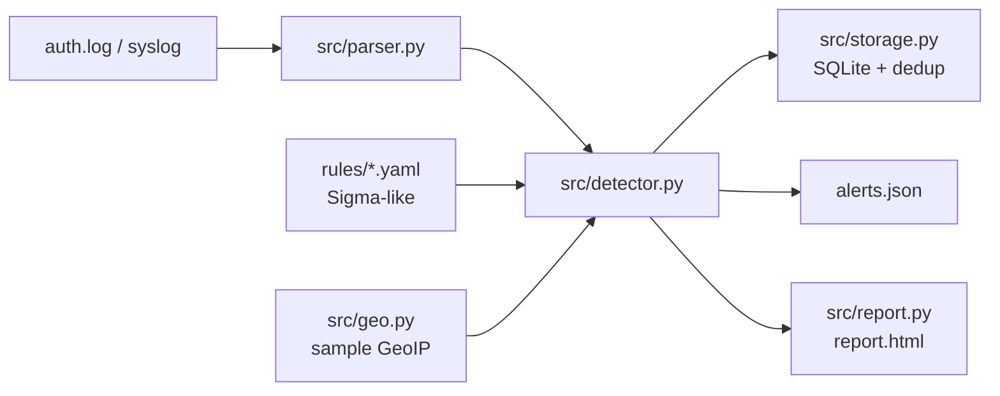

# 🛡️ SOC Sentinel Lite


A **mini SOC / SIEM in pure Python** — no external dependencies, no network access, no setup.
Feed it auth/syslog-style logs and it detects attacks, maps them to **MITRE ATT&CK**,
scores the risk, stores alerts in SQLite, and builds a self-contained HTML report.

Built as a portfolio project for SOC Analyst / Detection Engineering roles.

> **Sample data only.** Every IP in the bundled logs is an RFC 5737 documentation
> address (`192.0.2.0/24`, `198.51.100.0/24`, `203.0.113.0/24`). Nothing here
> touches a live host, a real credential, or a real network.

---

## What it does

| Stage | What happens |
|---|---|
| **Ingest** | Parses syslog / `auth.log` lines (`sshd`, `sudo`, `CRON`) into structured events |
| **Detect** | Correlates events against 6 Sigma-like YAML rules with sliding time windows |
| **Map** | Tags every alert with MITRE ATT&CK tactic + technique |
| **Score** | Risk score 0–100 from severity + observed count |
| **Store** | Persists alerts in SQLite with deduplication (re-ingesting the same log adds nothing) |
| **Report** | Emits a single self-contained `report.html` + machine-readable `alerts.json` |

## Why it matters for SOC roles in 2026

Hiring for SOC Analyst / Tier-1 roles now expects more than "I know what a SIEM is":
knowing **how detection actually works** — parsing, correlation windows, false-positive
control, MITRE mapping, and triage-ready output. This project demonstrates exactly that,
in ~600 lines of readable stdlib Python that a reviewer can run in 30 seconds with no
install step. It mirrors the real workflow of Splunk / Sentinel / Elastic detection
rules, minus the vendor lock-in.

## Architecture



```
sentinel.py            CLI entry point (argparse)
src/
  parser.py            syslog/auth.log line parser -> structured events
  rules.py             Sigma-like YAML loader (hand-rolled, stdlib only)
  detector.py          sliding-window correlation engine (R001-R006)
  geo.py               static sample IP -> country map (impossible travel)
  storage.py           SQLite alert store with UNIQUE-key dedup
  report.py            single-file HTML report generator
rules/                 one YAML file per detection rule
logs/sample_auth.log   146 realistic lines: normal traffic + 6 attack scenarios
tests/test_detector.py unittest suite (14 tests)
```

## Detection rules

| ID | Rule | MITRE | Severity | Trigger |
|---|---|---|---|---|
| R001 | SSH Brute Force | T1110.001 Password Guessing | High | 5+ failed logins, one IP, 5 min |
| R002 | Successful Login After Brute Force | T1078 Valid Accounts | **Critical** | Success from a brute-forcing IP within 30 min |
| R003 | Direct Root Login | T1078 Valid Accounts | High | Any successful `root` SSH login |
| R004 | SSH User Enumeration | T1595.001 Active Scanning | Medium | 8+ distinct usernames, one IP, 10 min |
| R005 | Impossible Travel | T1078 Valid Accounts | High | Same user, two countries, within 60 min |
| R006 | Sudo Privilege Escalation Attempts | T1548.003 Sudo and Sudo Caching | High | 3+ failed sudo attempts, one user, 10 min |

Rules are data, not code: tune `threshold`, `window_minutes` or `severity` in
`rules/*.yaml` and re-run — no Python changes needed. Disable a rule with `enabled: false`.

## Install

```bash
git clone https://github.com/<your-username>/soc-sentinel-lite.git
cd soc-sentinel-lite
# No dependencies to install — Python 3.9+ standard library only.
python3 --version
```

## Usage

```bash
python3 sentinel.py --input logs/sample_auth.log --output report.html --json alerts.json
```

Expected output (exact, from the bundled sample log — 146 events):

```
[+] Parsed 146 events from logs/sample_auth.log
[+] Loaded 6 rules from rules
[+] 7 alert(s) detected (critical=1, high=5, medium=1)
    [CRITICAL]  92  R002 Successful Login After Brute Force     203.0.113.45    user=admin  T1078
    [HIGH    ]  77  R001 SSH Brute Force                        203.0.113.45    user=admin, deploy, oracle, postgres, root, test  T1110.001
    [HIGH    ]  77  R001 SSH Brute Force                        192.0.2.77      user=admin, guest, oracle, root, test, user  T1110.001
    [HIGH    ]  75  R003 Direct Root Login                      198.51.100.23   user=root  T1078
    [HIGH    ]  75  R005 Impossible Travel                      198.51.100.10   user=alice  T1078
    [HIGH    ]  75  R006 Sudo Privilege Escalation Attempts     -               user=bob  T1548.003
    [MEDIUM  ]  54  R004 SSH User Enumeration                   192.0.2.77      user=admin, ftp, guest, mysql, oracle, root, support, test, ubuntu, user  T1595.001
[+] Stored 7 new alert(s) in alerts.db (0 duplicate(s) skipped)
[+] HTML report: report.html
[+] JSON alerts:  alerts.json
```

> R001 fires twice — once per attacking IP. That is by design: one alert per
> (rule, source IP, window), so a second attacker is never hidden behind the first.

More options:

```bash
# Custom rules dir and database, quiet mode (summary line only)
python3 sentinel.py --input /var/log/auth.log --rules rules/ --db alerts.db --quiet

# Run the test suite
python3 -m unittest discover -s tests -v
# Ran 14 tests ... OK

# Inspect stored alerts
python3 -c "import sqlite3; c=sqlite3.connect('alerts.db'); print(c.execute('SELECT rule_id, severity, risk_score, src_ip FROM alerts ORDER BY risk_score DESC').fetchall())"
```

Open `report.html` in any browser — summary cards, top offending IPs,
MITRE ATT&CK coverage table, and the full alert timeline. No server needed.

### Sample alert (`alerts.json`)

```json
{
  "rule_id": "R002",
  "rule_name": "Successful Login After Brute Force",
  "severity": "critical",
  "risk_score": 92,
  "src_ip": "203.0.113.45",
  "user": "admin",
  "first_seen": "2026-11-20T10:15:32",
  "last_seen": "2026-11-20T10:21:32",
  "count": 2,
  "mitre_tactic": "Initial Access",
  "mitre_technique": "T1078",
  "mitre_name": "Valid Accounts",
  "description": "Successful login for 'admin' from 203.0.113.45 6 min after brute-force activity — possible compromise."
}
```

## The sample log

`logs/sample_auth.log` (146 lines, 2026-11-20) mixes normal traffic
(`alice`, `bob`, `carol`, `deploy` logging in from `203.0.113.10`, routine `sudo`, cron)
with six attack scenarios:

1. **Brute force** — `203.0.113.45` fails 6 logins in 5 min, then logs in as `admin` (R001 + R002)
2. **Root login** — `198.51.100.23` logs in as `root` (R003)
3. **User enumeration** — `192.0.2.77` probes 10 usernames (R004, also trips R001)
4. **Impossible travel** — `alice` in PK, then the US 25 min later (R005)
5. **Sudo abuse** — `bob` fails sudo 3×, then succeeds to root (R006)

## Limitations

- **Syslog has no year** — timestamps assume 2026; pass your own year if you adapt the parser.
- **No live GeoIP** — country lookup is a static map for the sample IPs only; a real
  deployment would use MaxMind GeoLite2 or similar.
- **Batch, not streaming** — it analyses a finished log file; no tail-follow or live alerting yet.
- **Auth logs only** — no Windows Event Log, firewall, DNS or EDR telemetry (see Roadmap).
- **Correlations, not proof** — an alert means "this pattern matched", not "you are
  compromised". Always triage: check the evidence lines in `alerts.json` first.

## Ethical use

This is a **defensive** detection project. It contains no exploit code, no credential
stuffing, no scanning, and no payloads. Run it only on logs you own or are authorised
to analyse, and only against lab / sample data unless you have written permission.

## Roadmap

- [ ] Streaming mode (`tail -F` + live alerting)
- [ ] Windows Security Event Log (4625 / 4624) parser
- [ ] Real GeoIP via MaxMind GeoLite2
- [ ] Sigma rule import (full YAML via PyYAML, optional dependency)
- [ ] Baseline / allowlist to cut false positives (known admin IPs, service accounts)
- [ ] Email / Slack webhook notifier for critical alerts
- [ ] MITRE ATT&CK Navigator layer export

## Contributing

See [CONTRIBUTING.md](CONTRIBUTING.md). New rules are welcome: add one YAML file in
`rules/`, one detector function in `src/detector.py`, and tests in `tests/test_detector.py`.

## License

MIT — see [LICENSE](LICENSE).
